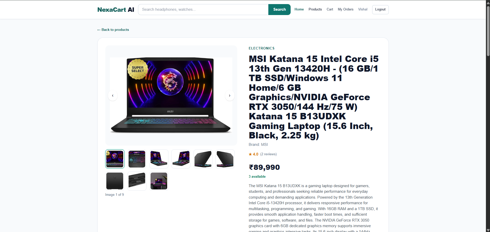
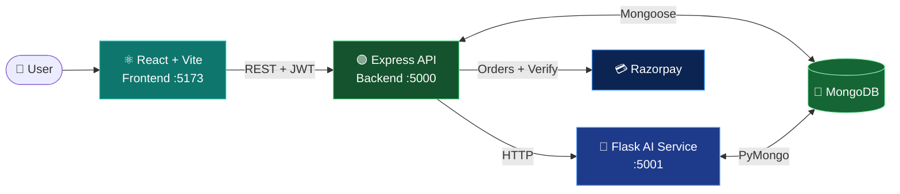
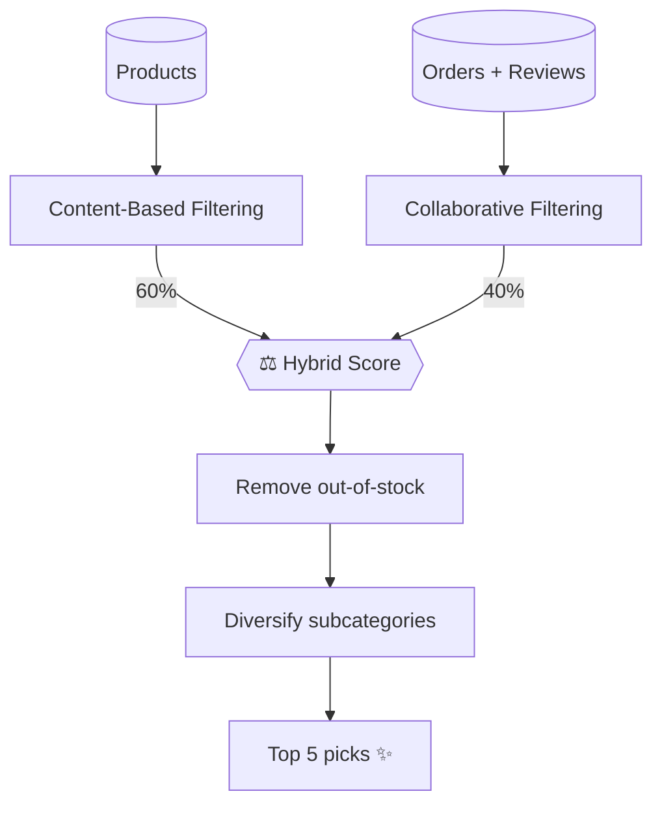

<div align="center">

<br/>


<h3>A full-stack e-commerce platform with a hybrid recommendation engine, secure payments and a complete admin panel.</h3>
 
<p><a href="#-features"><b>Features</b></a> · <a href="#-screenshots"><b>Screenshots</b></a> · <a href="#-architecture"><b>Architecture</b></a> · <a href="#-the-ai-recommendation-engine"><b>AI Engine</b></a> · <a href="#-getting-started"><b>Getting Started</b></a> · <a href="#-api-reference"><b>API</b></a></p>
</div>
<br/>
## 📖 Table of Contents
 
- [Overview](#-overview)
- [Features](#-features)
- [Screenshots](#-screenshots)
- [Architecture](#-architecture)
- [The AI Recommendation Engine](#-the-ai-recommendation-engine)
- [Tech Stack](#-tech-stack)
- [Project Structure](#-project-structure)
- [Getting Started](#-getting-started)
- [Environment Variables](#-environment-variables)
- [API Reference](#-api-reference)
- [Roadmap](#-roadmap)
- [Author](#-author)
---
 
## 🌟 Overview
 
**NexaCart AI** is a production-style e-commerce application built on the MERN stack and extended with a dedicated **Python AI microservice**. Customers browse, search, review and buy products with COD or Razorpay, while a hybrid recommender surfaces products they are most likely to want. Admins manage the catalogue and fulfil orders from a role-protected dashboard.
 
<div align="center">
| 🛍️ **Storefront** | 🤖 **AI Service** | 🔐 **Secure Checkout** | 🧑‍💼 **Admin Panel** |
|:---:|:---:|:---:|:---:|
| Search, filters, galleries, reviews | Content + collaborative hybrid | COD and Razorpay with server-side verification | Products, orders, status updates |
 
</div>
---
 
## ✨ Features
 
<table>
<tr>
<td width="50%" valign="top">
### 🛒 Customer Experience
- JWT authentication with role-based access
- Instant search by name, brand or description
- Category and subcategory filtering
- Product pages with a 9-image gallery, stock and ratings
- **"AI Recommended for You"** carousel
- Star ratings and written reviews
- Persistent cart with quantity controls
- Checkout with shipping address validation
- **Cash on Delivery** and **Razorpay** (cards and netbanking)
- Order confirmation and order history
</td>
<td width="50%" valign="top">
### 🧑‍💼 Admin Console
- Dedicated admin-only dashboard
- Add, edit, activate and deactivate products
- Live stats: total, active and inactive products
- Search across products, categories and subcategories
- View every customer order with payment details
- Update order status through its lifecycle
- Server-verified prices and stock at order time
</td>
</tr>
</table>
---
 
## 📸 Screenshots
 
<p align="center"><sub>Click any image to view it full size</sub></p>
<h3 align="center">🏠 Storefront</h3>
 
<table>
<tr>
<td width="33%" align="center" valign="top"><a href="screenshots/1.Home%20Page.png"></a><br/><sub><b>1 · Home</b></sub></td>
<td width="33%" align="center" valign="top"><a href="screenshots/2.Product%20Page.png"></a><br/><sub><b>2 · Explore Products</b></sub></td>
<td width="33%" align="center" valign="top"><a href="screenshots/3.Product.png"></a><br/><sub><b>3 · Product Details</b></sub></td>
</tr>
</table>
<h3 align="center">🤖 AI and Social Proof</h3>
 
<table>
<tr>
<td width="50%" align="center" valign="top"><a href="screenshots/4.AI%20Recommendations.png"></a><br/><sub><b>4 · AI Recommendations</b></sub></td>
<td width="50%" align="center" valign="top"><a href="screenshots/5.Customer%20Review.png"></a><br/><sub><b>5 · Customer Reviews</b></sub></td>
</tr>
</table>
<h3 align="center">💳 Cart to Confirmation</h3>
 
<table>
<tr>
<td width="33%" align="center" valign="top"><a href="screenshots/6.Cart%20Page.png"></a><br/><sub><b>6 · Cart</b></sub></td>
<td width="33%" align="center" valign="top"><a href="screenshots/7.Checkout%20Page.png"></a><br/><sub><b>7 · Checkout</b></sub></td>
<td width="33%" align="center" valign="top"><a href="screenshots/8.Order%20Confirmed%20Page.png"></a><br/><sub><b>8 · Order Confirmed</b></sub></td>
</tr>
</table>
<h3 align="center">🧑‍💼 Admin Panel</h3>
 
<table>
<tr>
<td width="33%" align="center" valign="top"><a href="screenshots/9.Admin%20DashBoard.png"></a><br/><sub><b>9 · Admin Dashboard</b></sub></td>
<td width="33%" align="center" valign="top"><a href="screenshots/10.Product%20Management.png"></a><br/><sub><b>10 · Product Management</b></sub></td>
<td width="33%" align="center" valign="top"><a href="screenshots/11.Manage%20Orders.png"></a><br/><sub><b>11 · Order Management</b></sub></td>
</tr>
</table>
---
 
## 🏗️ Architecture
 

 
The frontend never talks to the AI service directly. The Express backend proxies recommendation requests, keeping auth and CORS in one place.
 
---
 
## 🤖 The AI Recommendation Engine
 
The `ai-service` is a Flask microservice that reads products, orders and reviews from MongoDB and serves three recommendation strategies.
 

 
| Strategy | How it works |
|---|---|
| **Content-Based (CBF)** | Compares product attributes to find items similar to what the user likes |
| **Collaborative (CF)** | Learns from order and review behaviour across customers |
| **Hybrid** | Weighted blend: **60% CBF + 40% CF** |
 
**Built-in safeguards**
- ❄️ **Cold-start fallback:** uses CBF when there is no interaction history
- 📦 **Out-of-stock filtering:** never recommends unavailable products
- 🎨 **Diversity:** limits repeated subcategories in results
- 🎯 **Top-K:** returns up to 5 recommendations
**Evaluation:** Precision@5, Recall@5 and catalogue coverage are measured for all three algorithms. See [`EVALUATION_REPORT.md`](ai-service/EVALUATION_REPORT.md).
 
---
 
## 🧰 Tech Stack
 
<div align="center">
| Layer | Technologies |
|:---:|---|
| **Frontend** | React 19 · Vite · React Router 7 · Tailwind CSS · Axios · Lucide Icons |
| **Backend** | Node.js · Express 5 · Mongoose · JWT · bcryptjs · Razorpay SDK |
| **Database** | MongoDB |
| **AI Service** | Python · Flask · pandas · NumPy · scikit-learn · PyMongo |
 
</div>
---
 
## 📁 Project Structure
 
```
NexaCart-AI/
├── 🎨 frontend/
│   ├── public/                 # Product image galleries
│   └── src/
│       ├── api/                # Axios clients (products, cart, orders, reviews, admin)
│       ├── components/         # Navbar, ProductCard, ProductReviews, ProtectedRoute
│       ├── context/            # AuthContext
│       └── pages/              # Home, Products, ProductDetails, Cart, Checkout, Orders, Admin*
│
├── ⚙️ backend/
│   ├── config/                 # DB and Razorpay setup
│   ├── middleware/             # protect, authorizeRoles
│   ├── models/                 # User, Product, Cart, Order, Review
│   ├── routes/                 # auth, products, cart, orders, reviews, admin, ai
│   └── server.js
│
└── 🧠 ai-service/
    ├── app.py                  # Flask app and endpoints
    ├── hybrid.py               # Weighted hybrid recommender
    ├── collaborative.py        # Collaborative filtering
    ├── evaluation.py           # Precision@K, Recall@K, coverage
    └── EVALUATION_REPORT.md
```
 
---
 
## 🚀 Getting Started
 
### Prerequisites
 


### 1 · Clone
 
```bash
git clone https://github.com/vishal-4696/NexaCart-AI.git
cd NexaCart-AI
```
 
### 2 · Backend
 
```bash
cd backend
npm install
npm run dev
```
 
### 3 · AI Service
 
```bash
cd ai-service
python -m venv venv
source venv/bin/activate        # Windows: venv\Scripts\activate
pip install -r requirements.txt
python app.py
```
 
### 4 · Frontend
 
```bash
cd frontend
npm install
npm run dev
```
 
<div align="center">
| Service | URL |
|:---:|:---:|
| 🎨 Frontend | `http://localhost:5173` |
| ⚙️ Backend | `http://localhost:5000` |
| 🧠 AI Service | `http://localhost:5001` |
 
</div>
---
 
## 🔐 Environment Variables
 
<details>
<summary><b>⚙️ backend/.env</b></summary>
```env
PORT=5000
MONGODB_URI=your_mongodb_connection_string
JWT_SECRET=your_jwt_secret
CLIENT_URL=http://localhost:5173
AI_SERVICE_URL=http://127.0.0.1:5001
RAZORPAY_KEY_ID=your_razorpay_key_id
RAZORPAY_KEY_SECRET=your_razorpay_key_secret
```
 
</details>
<details>
<summary><b>🧠 ai-service/.env</b></summary>
```env
MONGODB_URI=your_mongodb_connection_string
```
 
</details>
<details>
<summary><b>🎨 frontend/.env (optional)</b></summary>
```env
VITE_API_URL=http://localhost:5000/api
```
 
</details>
---
 
## 📡 API Reference
 
Base URL: `http://localhost:5000/api`
 
<details>
<summary><b>🔑 Auth</b></summary>
| Method | Endpoint | Access | Description |
|:---:|---|:---:|---|
| `POST` | `/auth/register` | Public | Create account |
| `POST` | `/auth/login` | Public | Login and receive JWT |
| `GET` | `/auth/me` | Auth | Current user |
 
</details>
<details>
<summary><b>🛍️ Products</b></summary>
| Method | Endpoint | Access | Description |
|:---:|---|:---:|---|
| `GET` | `/products` | Public | List and filter products |
| `GET` | `/products/:id` | Public | Product details |
| `GET` | `/products/admin/all` | Admin | All products incl. inactive |
| `POST` | `/products` | Admin | Create product |
| `PATCH` | `/products/:id` | Admin | Update, activate or deactivate |
 
</details>
<details>
<summary><b>🛒 Cart</b></summary>
| Method | Endpoint | Description |
|:---:|---|---|
| `GET` | `/cart` | Get cart |
| `POST` | `/cart/items` | Add item |
| `PATCH` | `/cart/items/:productId` | Update quantity |
| `DELETE` | `/cart/items/:productId` | Remove item |
| `DELETE` | `/cart` | Clear cart |
 
</details>
<details>
<summary><b>📦 Orders and Payments</b></summary>
| Method | Endpoint | Access | Description |
|:---:|---|:---:|---|
| `POST` | `/orders` | Customer | Place COD order |
| `POST` | `/orders/razorpay/create-order` | Customer | Create Razorpay order |
| `POST` | `/orders/razorpay/verify-payment` | Customer | Verify payment signature |
| `POST` | `/orders/razorpay/checkout-status` | Customer | Check checkout status |
| `GET` | `/orders/my-orders` | Customer | Order history |
| `GET` | `/orders/:id` | Auth | Order details |
| `GET` | `/orders` | Admin | All orders |
| `PATCH` | `/orders/:id/status` | Admin | Update order status |
 
</details>
<details>
<summary><b>⭐ Reviews</b></summary>
| Method | Endpoint | Description |
|:---:|---|---|
| `GET` | `/reviews/:productId` | Get product reviews |
| `POST` | `/reviews/:productId` | Add a review |
 
</details>
<details>
<summary><b>🤖 AI Recommendations</b></summary>
| Method | Endpoint | Description |
|:---:|---|---|
| `GET` | `/ai/recommendations/content` | Content-based |
| `GET` | `/ai/recommendations/collaborative` | Collaborative |
| `GET` | `/ai/recommendations/hybrid` | Hybrid (60/40) |
| `GET` | `/ai/recommendations/similar` | Similar products |
 
</details>
<details>
<summary><b>🧑‍💼 Admin</b></summary>
| Method | Endpoint | Description |
|:---:|---|---|
| `GET` | `/admin/dashboard` | Dashboard data |
| `GET` | `/admin/orders` | Orders overview |
 
</details>
---
 
## 🗺️ Roadmap
 
- [x] JWT auth with customer and admin roles
- [x] Product catalogue, search and filters
- [x] Cart, checkout, COD and Razorpay
- [x] Reviews and ratings
- [x] Hybrid AI recommendations with evaluation report
- [x] Admin product and order management
- [ ] Larger dataset for stronger recommendation metrics
- [ ] Automated test suite
- [ ] Wishlist
- [ ] Deployment: frontend, backend and AI service
---
 
## 👤 Author
 
<div align="center">
**Vishal**
 
[](https://github.com/vishal-4696)
[](https://linkedin.com/in/vishal-d6476)
 
<br/>
<b>⭐ If you like this project, give it a star. ⭐</b>
 

</div>
 
